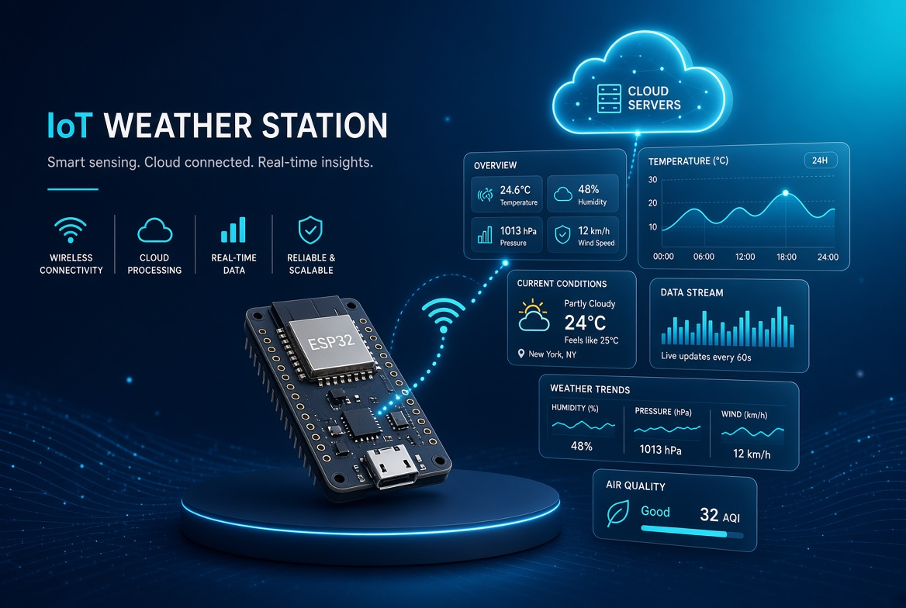

# 🌍 Global Microclimate Observatory & Climate Data Science Platform

> A scalable IoT and data science architecture for long-term microclimate monitoring, environmental data collection, and meteorological trend analysis.



**Current version:** `climate_station_v0.1`

---

## 🔬 Project Vision & Objectives

This project moves beyond standard hobbyist weather displays to establish a rigorous, data-driven environmental observatory. By combining redundant edge hardware, cloud-native persistence, and a robust statistical data science pipeline, the platform is engineered to:

* **Quantify Microclimatic Dynamics:** Monitor high-resolution temperature, humidity, light irradiance, and atmospheric changes over extended temporal scales.
* **Ensure Data Integrity:** Implement dual-sensor hardware redundancy and automated outlier filtering (Z-score analysis) to eliminate environmental noise and sensor drift.
* **Apply Scientific Modeling:** Model thermodynamic properties (dew point via the Magnus formula) and temporal rates of change (thermal inertia) to extract deep insights into localized climate behavior.

---

## 🏛️ System Architecture

The platform is structured into a three-tier IoT and data science architecture:

1. **Edge Layer (Hardware & Firmware):**
   * ESP32 microcontroller managing concurrent sensor polling.
   * Dual-sensor redundancy ($T_1/H_1$ and $T_2/H_2$) for cross-validation and uncertainty reduction.
   * Analog front-end using voltage dividers for light-dependent resistors (LDRs), mapped to ADC1-only channels.
   * Local visualization via an I2C SSD1306 OLED display.

2. **Cloud & Storage Layer:**
   * Secure HTTPS ingestion pipeline transmitting time-series payloads to a cloud NoSQL database (Firebase/Firestore).
   * Structured schema design optimized for historical time-series retrieval.

3. **Analytics & Intelligence Layer:**
   * Python-based ETL and exploratory data analysis (EDA) pipeline using Pandas, NumPy, and SciPy.
   * Automated cleaning, normalization, and statistical modeling workflows.

---

## 📊 Scientific Methodology & Mathematical Models

To transform raw telemetry into actionable climate intelligence, the analytics pipeline applies the following mathematical foundations:

### 1. Thermodynamic Index (Dew Point via Magnus Formula)

$$T_{dp} = \frac{b \cdot \alpha(T, H)}{a - \alpha(T, H)}$$

Where $\alpha(T, H) = \frac{a \cdot T}{b + T} + \ln\left(\frac{H}{100}\right)$, with empirical constants $a = 17.62$ and $b = 243.12^\circ\text{C}$.

### 2. Thermal Inertia (Temporal Rate of Change)

$$\frac{\Delta T}{\Delta t} = \left( \frac{T_{t_2} - T_{t_1}}{t_2 - t_1} \right) \times 60$$

### 3. Multivariable Correlation (Pearson's $r$)

$$r_{xy} = \frac{\sum_{i=1}^{n} (x_i - \bar{x})(y_i - \bar{y})}{\sqrt{\sum_{i=1}^{n} (x_i - \bar{x})^2} \sqrt{\sum_{i=1}^{n} (y_i - \bar{y})^2}}$$

### 4. Anomaly Detection (Z-Score Filtering)

$$Z = \frac{x - \mu}{\sigma}$$

---

## 🚀 Future Roadmap & Scalability

The observatory is architected for continuous evolution, detailed in [`future_implementations/climate_station_v0.1.md`](future_implementations/climate_station_v0.1.md):

* **Advanced sensor integration:** SHT31 (high-precision temperature/humidity), BMP280 (barometric pressure/altitude), MQ gas sensor suite (air quality, VOCs, pollutants).
* **Server-side automation:** scheduled serverless ETL pipelines and continuous schema validation.
* **Web & dashboard expansion:** interactive real-time visualization (Grafana / Streamlit / React) and predictive meteorological modeling.

---

## 📁 Repository Structure

Each stage of the project is versioned inside its own `climate_station_v0.1/` subfolder:

```text
├── firmware/               climate_station_v0.1/   ESP32 source code and sensor polling logic
├── hardware/                climate_station_v0.1/   Fritzing schematics and physical wiring diagrams
├── data/                    climate_station_v0.1/   Raw Firestore exports and cleaned datasets
├── notebooks/               climate_station_v0.1/   Python EDA and scientific modeling notebooks
├── assets/                  climate_station_v0.1/   Project photo and visual assets
├── reports/                 climate_station_v0.1.md Project status report
├── future_implementations/  climate_station_v0.1.md Roadmap & scalability strategy
└── LICENSE
```

See [`reports/climate_station_v0.1.md`](reports/climate_station_v0.1.md) for the detailed breakdown of the current hardware, firmware, backend, and data pipeline, and [`future_implementations/climate_station_v0.1.md`](future_implementations/climate_station_v0.1.md) for the full roadmap.

---

## Credits

Fritzing parts used in the hardware diagrams:

* **DHT11** — by [ysfk (Yusuf KARAHAN)](https://forum.fritzing.org/t/dht11-3pin-isi-ve-nem-sensoru/33889)
* **SSD1306 0.96" OLED** — by [ysfk (Yusuf KARAHAN)](https://forum.fritzing.org/t/ssd1306-096-oled-128x64-4pin-yellow-blue/33887)
* **ESP32 DevKit** — by [vanepp (Peter Van Epp)](https://forum.fritzing.org/t/esp-32-de-30-pines/22637)

## License

[MIT](LICENSE)

