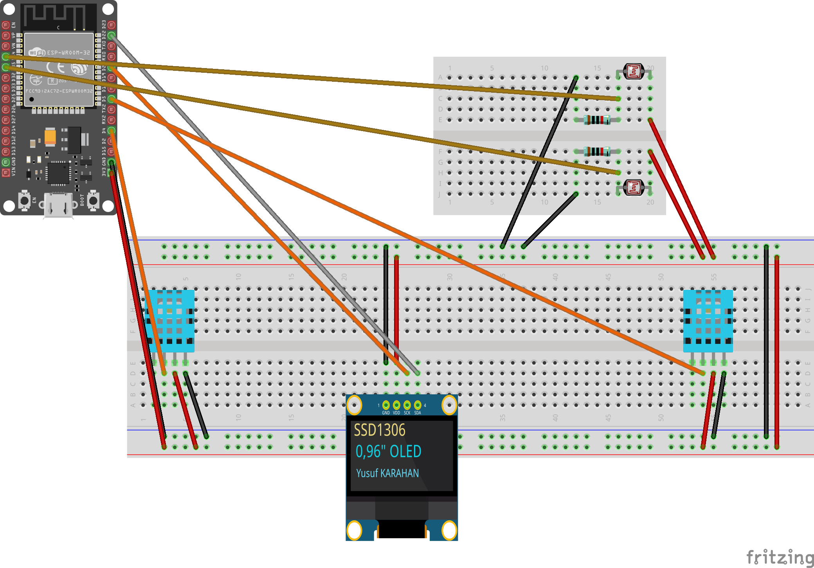
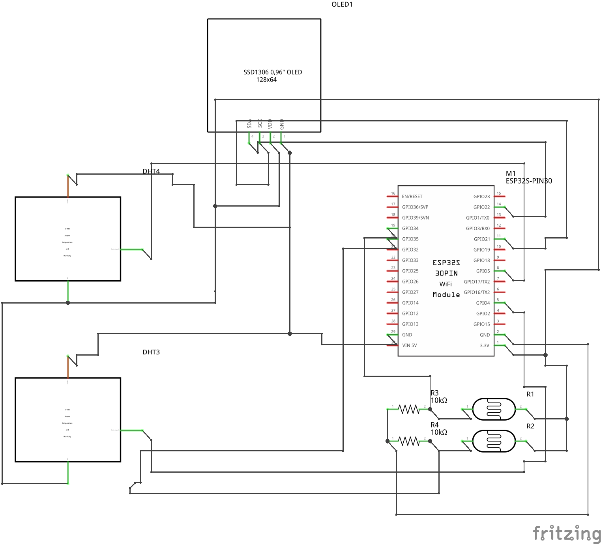

# Climate Station v0.1 — Project Report

## Status

First functional version of the IoT weather station: firmware deployed, backend ingesting data in Firestore, and a complete data science pipeline validated against local CSV exports.

## Hardware

- **ESP32 DevKit** as the main controller.
- **2x DHT11** (temperature/humidity) on GPIO 4 and GPIO 5, for twin-sensor redundancy and cross-validation.
- **2x LDR** (ambient light) on GPIO 34 and GPIO 35 (ADC1-only pins, no internal pull-up/down).
- **OLED SSD1306 0.96"** display over I2C (SDA = GPIO 21, SCL = GPIO 22, address `0x3C`) for local status readout.
- Circuit diagrams authored in Fritzing: breadboard view, schematic view, and the editable `.fzz` source, stored under `hardware/climate_station_v0.1/`.

### Breadboard diagram

### Wiring / schematic diagram

## Firmware

- `firmware/climate_station_v0.1/weather_code.ino` reads both DHT11 sensors and both LDRs every cycle, shows live readings on the OLED, and sends an HTTPS `POST` to a Firebase Cloud Function ingestion endpoint, authenticated with an `x-api-key` header.
- Sampling/send interval: every 5 minutes.
- All comments and display strings translated to English.

## Backend

- **Firebase Firestore**, collection `weather_readings`.
- Fields stored per reading: `t1`, `h1`, `t2`, `h2`, `t_avg`, `h_avg`, `l1`, `l2`, `l_avg`, `timestamp`.

## Data science pipeline

`notebooks/climate_station_v0.1/weather_data_science.ipynb` documents the hardware architecture and runs the full analysis pipeline:

1. **Loading**: raw readings loaded from [`data/weather_raw_data.csv`](../data/climate_station_v0.1/weather_raw_data.csv) (originally extracted from Firestore).
2. **Quality control**:
   - Packet loss rate (expected vs. actual records on a 5-minute cadence).
   - ADC saturation filtering on the LDRs (values ≥ 4095 → `NaN` + linear interpolation).
   - Twin-sensor cross-validation with **MAE** and **RMSE** between $T_1/T_2$ and $H_1/H_2$.
3. **Descriptive statistics**: mean, median, standard deviation, IQR, and absolute extremes with timestamps.
4. **Derived thermodynamic indices**:
   - Dew point via the Magnus formula.
   - Thermal rate of change ($\Delta T/\Delta t$, °C/h).
5. **Time series**: rolling averages, hourly profiles, and photoperiod detection.
6. **Correlation and anomaly detection**: Pearson correlation, scatter plots, and Z-score based outlier flagging.

The cleaned dataset is exported to [`data/weather_clean_data.csv`](../data/climate_station_v0.1/weather_clean_data.csv) and reused by every later cell in the notebook.

## Repository reorganization

- Split the originally flat repository into `firmware/`, `hardware/` (with a `fritzing/` subfolder), `notebooks/`, `data/`, `assets/`, and `reports/`.
- Moved the raw/clean CSV exports into `data/` and updated every notebook reference accordingly.
- Translated the entire project (firmware comments, notebook markdown/code, README) to English.
- Added an MIT `LICENSE`.
- Added a project photo at `assets/climate_station_v0.1/weather_sistem.jpg`, referenced from the README.
- Each project folder (`firmware/`, `hardware/`, `notebooks/`, `data/`, `assets/`) now holds its current content inside a `climate_station_v0.1/` subfolder, versioning this release.

## Known limitations / next steps

- Packet loss rate currently around 5.94% over the observed interval, attributed to residential Wi-Fi drops — acceptable for this use case but worth monitoring.
- Notebook currently loads from the local raw CSV instead of connecting live to Firestore; a live-extraction cell can be reintroduced if recurring automated exports are needed.
